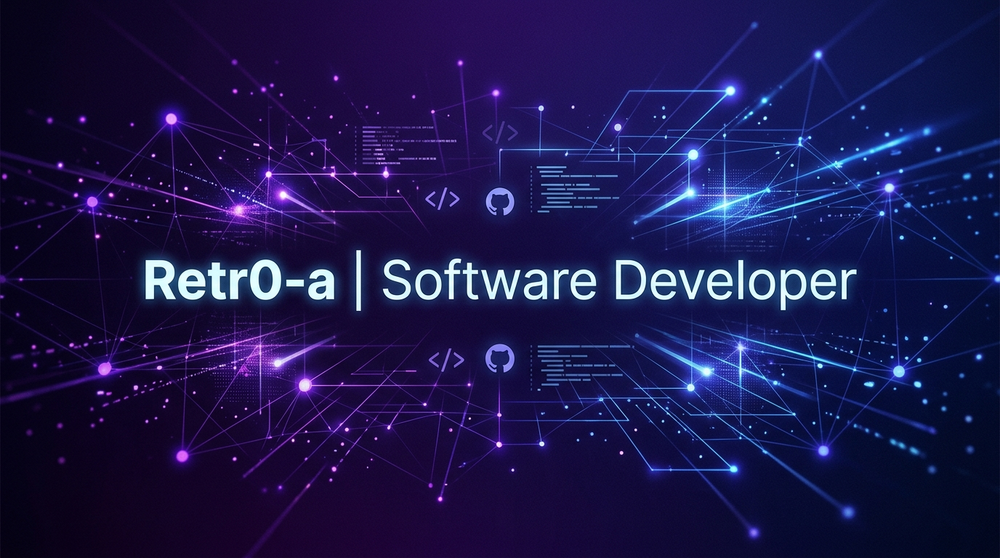

# Perfil Personal - Retr0-a

<h2 align="center">👋 ¡Hola! Soy Andrés (Retr0-a)</h2>

  <strong>Software Developer en <a href="https://simcod.ec">SimCodec</a></strong>

  
  

---

### 🚀 Sobre Mí
- 🏢 Formo parte activa de **[SimCodec](https://github.com/simcodec)**, empresa de Quito, Ecuador, especializada en desarrollo de software, automatización e infraestructura tecnológica.
- 💻 Me apasiona construir soluciones eficientes utilizando tecnologías frontend y backend modernas, automatizaciones complejas de scraping y despliegues robustos.
- ⚡ Intereses principales: Front-End Development, Cloud Computing, DevOps y Redes.

---

### 🛠️ Tecnologías y Herramientas

---

### 📊 Mis Métricas de GitHub (En Tiempo Real)
Estadísticas avanzadas generadas dinámicamente con las métricas de mi perfil:

---

### 🔥 Racha de Contribuciones (Streak Stats)

---

### 📈 Gráfico de Actividad de Codificación
Visualización detallada del historial de desarrollo semanal y diario:

---

### 📫 Conectemos
*   🏢 Sitio Corporativo: [simcod.ec](https://simcod.ec)
*   📧 Correo Electrónico: [andres@epic.ec](mailto:andres@epic.ec)
*   💼 GitHub: [@Retr0-a](https://github.com/Retr0-a)
*   🏢 Organización GitHub: [simcodec](https://github.com/simcodec)

 

  

